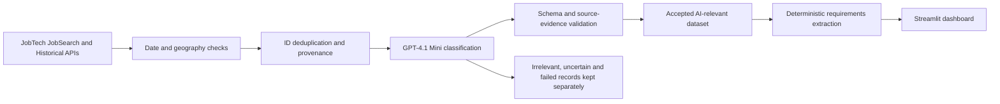

# Swedish Data & AI Job Market Analyzer

An end-to-end Python portfolio project exploring what Data & AI job advertisements ask candidates to know. It combines auditable collection from Swedish JobTech APIs, GPT-4.1 Mini classification, deterministic requirements extraction and an interactive Streamlit dashboard.

The motivation is to separate occupational relevance from keyword matches, and actual applicant requirements from technologies mentioned in passing. Every extracted fact retains its original excerpt and character offsets so a reader can inspect the evidence behind a chart.

## Try the dashboard

**No API key or local research data is needed.** A fresh clone opens the real Step 7 research snapshot: 1,778 AI-classified relevant advertisements, with 1,111 core-industry advertisements in the default view. Existing local research publications take precedence, so the working research dashboard is preserved.

Install **64-bit Python 3.14** from python.org (include the Python launcher) and Git for Windows. Python 3.11 or newer satisfies the declared package requirements; Python 3.14 is the tested version. Clone this repository, open PowerShell in its root directory, then run:

```powershell
py -3.14 -m venv .venv
.\.venv\Scripts\python.exe -m pip install --upgrade pip
.\.venv\Scripts\python.exe -m pip install -r requirements.txt
.\.venv\Scripts\python.exe -m pip check
.\.venv\Scripts\python.exe -m streamlit run dashboard/app.py
```

Use a short checkout path, such as `C:\src\swedish-data-jobs`, when running the full test suite: deeply nested Windows paths can exceed the legacy path limit in mock checkpoint filenames.

No virtual-environment activation or execution-policy change is required. Installation requires internet access to the package index; running the dashboard requires no API key. If `py` is unavailable, install the Python launcher or use the installed Python 3.14 executable for the first command.

On macOS/Linux, from the repository root:

```bash
python3 -m venv .venv
.venv/bin/python -m pip install -r requirements.txt
.venv/bin/python -m streamlit run dashboard/app.py
```

Open [localhost:8501](http://localhost:8501). To select the fictional demo explicitly:

```powershell
$env:JOBS_DASHBOARD_DATA = "examples/demo_dataset"
.\.venv\Scripts\python.exe -m streamlit run dashboard/app.py
```

On macOS/Linux, use `JOBS_DASHBOARD_DATA=examples/demo_dataset python -m streamlit run dashboard/app.py`.

To use the existing full local publication instead, set `JOBS_DASHBOARD_DATA` to `data/processed/step7-expanded-20261024`. Unset the variable to restore automatic discovery of the latest completed publication. The dashboard reports missing or invalid explicit paths without downloading, classifying or overwriting anything.

## Findings from the collected subset

The research run covers candidate advertisements dated **21 April to 21 October 2026**. These figures are model-derived results from a collected subset, **not verified counts for the entire Swedish job market**.

| Measure | Advertisements |
|---|---:|
| Collected candidates | 5,023 |
| Successfully classified, including validated exact-source reuse | 3,138 |
| Accepted, source-grounded AI-relevant classifications | 1,778 |
| Core-industry advertisements in the default view | 1,111 |
| Jobs with usable requirements evidence, all relevant scopes | 1,035 |
| Jobs with usable requirements evidence, core industry | 611 |
| Recorded strict v3 duties-audit approvals | 214 |

The largest primary categories across all relevant scopes are AI/ML Research (351), Data Engineer (333), AI Engineer (209), Data/AI Management (170) and Data Analyst (151). Each advertisement contributes to exactly one primary-category total; secondary categories do not add advertisements. Research opportunities and adjacent roles are separate from the default core-industry view.

See [the aggregate results and category breakdown](docs/results.md). The committed public research profiles reproduce these findings. The fictional demo remains an explicitly labeled sidebar alternative. See [public data, licensing, privacy, methodology and denominators](docs/public_research.md).

## How the pipeline works



1. **Collect:** Search the Swedish JobTech JobSearch and Historical APIs using documented queries, Swedish geography and publication dates. Preserve raw responses and query provenance locally. See [API decisions and official references](docs/api_notes.md).
2. **Clean and classify:** Normalize working text without replacing original descriptions. GPT-4.1 Mini assigns relevance, primary/secondary occupation categories, scope, opportunity flags and supporting source evidence. Validate accepted outputs against the saved schema and original text.
3. **Reuse safely:** Compatible caches and completed classifications avoid repeated paid requests. The corpus workflow provides dry runs, conservative budget reservations, checkpoints and safe resume. Unknown request outcomes stay reserved and are not automatically retried.
4. **Include:** The approved [Step 7 policy](docs/step7_ai_relevant_policy_v1.md) accepts schema-valid, source-grounded, relevant AI classifications. Historical v3 duties audits remain quality metadata and an optional filter, rather than a mandatory gate. Uncertain, irrelevant, invalid and failed classifications stay outside the analysis.
5. **Extract:** Existing deterministic rules extract skills, cloud platforms, tools, Swedish/English language, education, professional experience and explicit seniority. Distinguish required, preferred, required alternatives, merely mentioned, ambiguous and negated qualifications; retain exact source offsets.
6. **Publish:** Merge by advertisement ID, preserve original classifications and evidence, write a new versioned publication and verify historical file hashes. Refresh the dashboard only from completed publications.

## Dashboard

The dashboard uses a light navy-and-teal theme with four focused sections: **Overview**, **Skills & Technologies**, **Qualifications**, and **Locations**. Overview leads with three career paths (Data Engineering, Data Science & Machine Learning, and Data Analytics); other and unresolved primary categories remain separately visible. Grouping is presentation-only and never counts secondary categories as additional advertisements.

The default view shows **all accepted AI-relevant jobs within core industry**. Shared sidebar filters cover career path, detailed category, region, scope, audit quality and seniority. Advanced controls retain saved AI scope, opportunity types and multi-role distinctions. Remove **All** before selecting specific values; an empty selection returns no jobs. **Reset Filters** restores the default selection. Dataset changes reset incompatible filters automatically.

Interactive Plotly charts share a counts/percentages control. Technology comparisons use each career path's filtered advertisement count as their denominator. Other requirement percentages use **all distinct advertisements in the current filtered selection**, including jobs with missing evidence. Required, preferred, required-alternative and merely mentioned evidence remain distinct. Skills and education levels can overlap, so percentages must not be added. Missing evidence does not mean a requirement is absent. Advertisements are not unique vacancies.

Searchable, sortable detail tables and evidence coverage sit in expandable panels. **About / Methodology** contains research limitations and processing metadata. Private local datasets retain original advertisement text, classification provenance and downloadable evidence. Public snapshots expose counted statistical profiles only. Dataset loading and processing metadata are cached against file modification times; no external requests run when viewing the dashboard.

## Technologies

Python, requests, pandas, GPT-4.1 Mini through an OpenAI-compatible HTTP interface, deterministic text rules, Streamlit, Plotly, Jupyter and Python unittest. Direct dependencies are pinned in `requirements.txt`; no paid API is needed to run the demo or automated tests.

## Repository structure

```text
src/                 Collection, validation, classification, extraction and publications
dashboard/          Streamlit application (dashboard/app.py)
config/              Public search terms
prompts/             Versioned classifier prompts
notebooks/           Offline demo and research evaluation notebooks
  archive/           Early API and heuristic exploration, with outputs cleared
tests/               Mocked unit tests, demo tests and optional local-data regression tests
docs/                Methodology, results, workflow and repository guide
  archive/           Historical-stage index (frozen referenced modules stay in src/)
examples/            Public statistical research profiles and fictional demo
tools/               Offline demo generation and repository security checks
.github/workflows/   Public-clone test and hygiene checks
requirements.txt     Pinned direct dependencies
.env.example         Empty credential placeholders; no secrets
```

`data/`, `.env`, API caches, checkpoints, logs and local archives are deliberately ignored by Git. Full research datasets remain local. See [the repository guide](docs/repository_guide.md) for current entry points, historical modules and the Git preparation checklist.

## Development and reproducibility

```bash
python -m unittest discover -s tests -q
python -m tools.check_repository --scan-history
python -m pip check
```

Tests use synthetic network responses. Tests that require private local research artifacts are explicitly skipped in a fresh clone; portable unit tests and demo/evidence/filter checks still run. The [offline demo notebook](notebooks/01_dashboard_demo.ipynb) also works without the local collection. Rebuild its fictional fixture using `python -m tools.build_demo`.

The actual research pipeline requires original inputs that are intentionally not redistributed. Historical experiment notebooks require their corresponding local runs. See [full corpus workflow](docs/full_corpus_workflow.md), [requirements schema](docs/requirements_extraction_schema.md) and [Step 7 policy](docs/step7_ai_relevant_policy_v1.md). The pipeline is auditable, but a fresh clone is not claimed to reproduce the research totals without those inputs.

### API configuration

Copy `.env.example` to `.env` for your own reference, but **the project does not load `.env` automatically**. Export credentials in your shell or credential manager. Viewing the dashboard and extracting requirements are offline. Live classification requires an explicit execution flag and budget; never run it just to launch the dashboard. Do not commit credentials, receipts or checkpoints.

## Methodology and limitations

- Search terms, JobTech/Platsbanken coverage, pagination and archival lag limit recall; this is not a representative sample of all Swedish employment demand.
- AI classifications are provisional and have not been independently verified. Source-grounded evidence establishes traceability, not proof that the occupational judgment is correct.
- Academic research, governance, adjacent roles and student/restricted opportunities remain distinguishable. Opportunity reporting scope takes precedence over academic scope; original scopes and overlapping flags remain available.
- Distinct advertisement IDs can describe repeated content or recruitment campaigns. Same-content copies are identifiable and retained when their IDs differ.
- Deterministic rules can miss wording or misinterpret context. Required alternatives are not individually mandatory. Language conflicts remain unspecified; years are not inferred from seniority.
- The 1,778 relevant advertisements are the accepted analyzed subset, not the full collection. Evidence coverage varies by requirement type and filter.

The project publishes aggregate research findings and synthetic examples, while preserving original advertisements and audit evidence locally.
